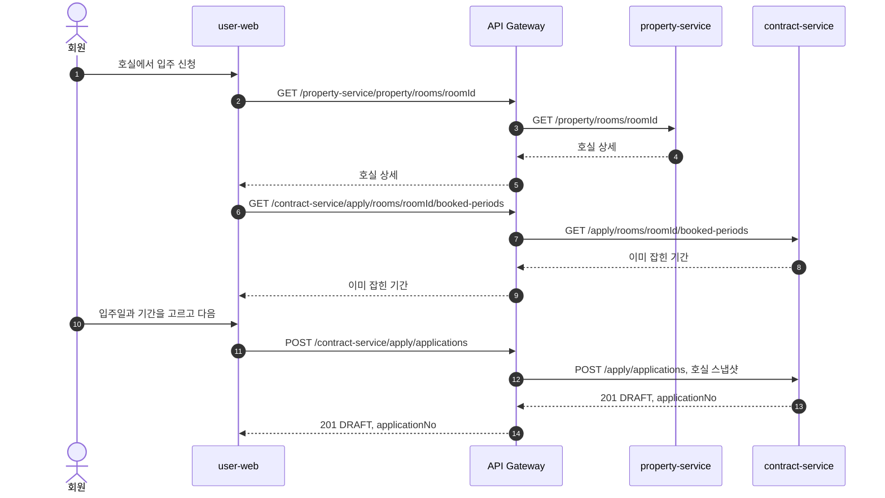
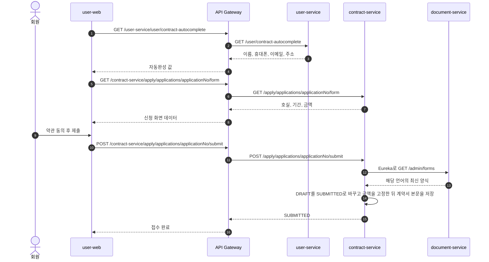
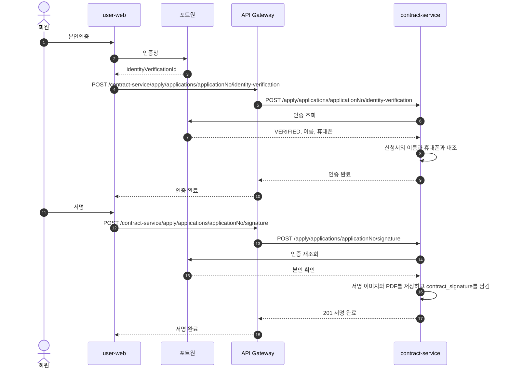
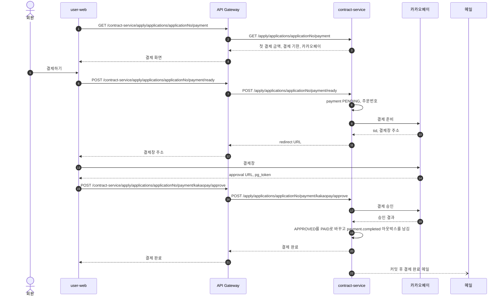
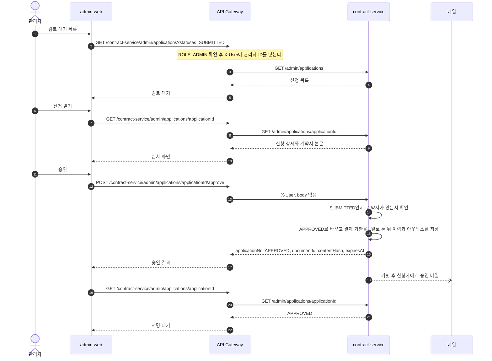
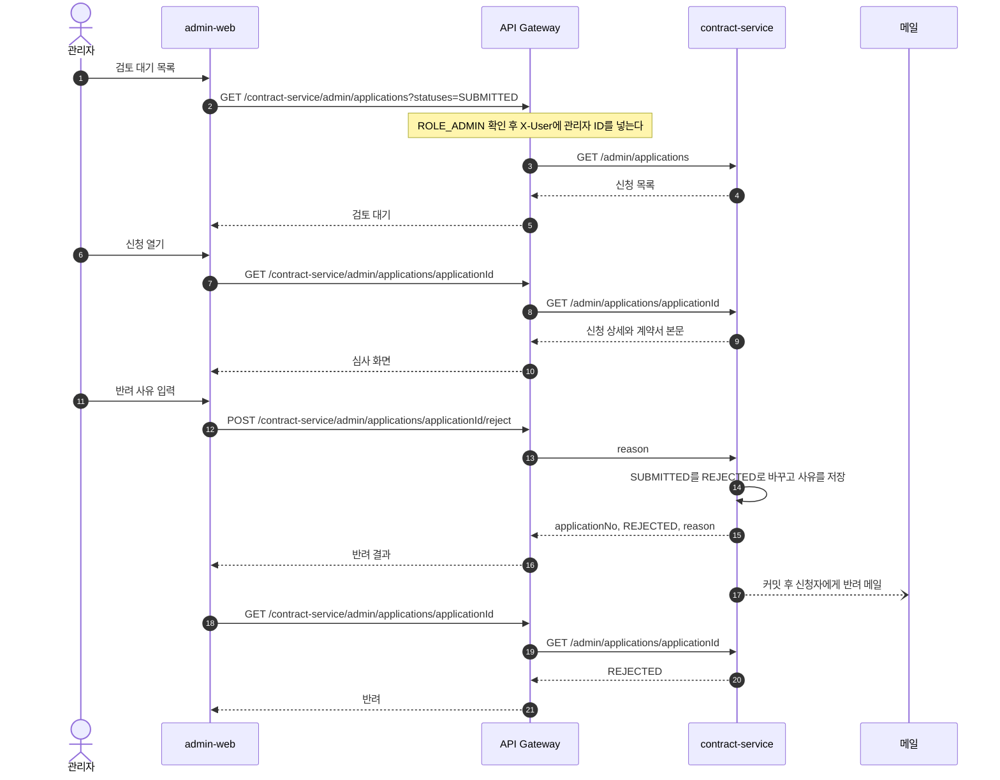

# 계약 시퀀스

사용자 입주 계약과 관리자 심사의 기본 흐름입니다.
브라우저 호출은 API Gateway를 지납니다. Gateway는 로그인 토큰을 확인하고 `X-User`에 회원 ID를 넣으며, `/contract-service`, `/property-service`, `/user-service` 접두사를 제거합니다.

상태 변경은 같은 트랜잭션에서 이력과 `outbox_event`를 남깁니다. 커밋 뒤에 아웃박스 스케줄러가 Kafka `contract.status-changed`를 보내고, 승인·반려·결제 완료는 메일을 보냅니다.

## 사용자 계약

호실 선택부터 계약금 결제까지입니다. 상태는 `DRAFT`, `SUBMITTED`, 관리자 승인 뒤 `APPROVED`, 결제 뒤 `PAID` 순서입니다. 서명은 `APPROVED` 이후에만 됩니다. 입주일이 되면 스케줄러가 `PAID`를 `COMPLETED`로 바꿉니다.

| 단계 | 상태 | 결과 |
|------|------|------|
| 1. 호실 선택 | `DRAFT` | 신청번호 발급 |
| 2. 신청서 제출 | `SUBMITTED` | 계약서 본문 생성, 심사 대기 |
| 3. 본인인증과 전자 서명 | `APPROVED` | 인증을 대조한 뒤 서명 이미지와 PDF 저장 |
| 4. 계약금 결제 | `PAID` | 결제 완료 메일 |

3단계 전에 [관리자 승인](#관리자-승인)이 끝나야 합니다. 승인 전에는 서명과 결제가 거절됩니다.

### 1. 호실 선택

같은 회원의 같은 호실 `DRAFT`가 기한 안이면 새로 만들지 않고 기간만 고칩니다.

### 2. 신청서 제출

제출에 실패하면 신청서는 `DRAFT`로 남고, 다시 제출할 수 있습니다. 심사 중 취소는 `SUBMITTED`에서 `CANCELED`입니다.

### 3. 본인인증과 전자 서명

관리자 승인으로 `APPROVED`가 되고 결제 기한 1일이 시작된 뒤입니다. 본인인증 호출은 포트원 결과를 신청서의 이름·휴대폰과 대조만 하고 저장하지 않습니다. 서명 제출 때 같은 인증을 한 번 더 조회합니다. 문서 해시가 저장된 계약서와 다르면 거절합니다.

### 4. 계약금 결제

결제 준비에 실패하거나 결제창을 닫아도 신청서는 `APPROVED`로 남고, 기한 안에 다시 결제할 수 있습니다.

## 관리자 승인

admin-web 계약서 화면입니다. 계약서 본문은 신청 제출 때 이미 만들어져 있고, 검토 대기인 `SUBMITTED`만 승인하거나 반려할 수 있습니다. 두 관리자가 동시에 처리하면 늦은 요청은 버전 충돌로 409가 됩니다.

### 승인

승인은 상태와 결제 기한만 바꿉니다. 결제 기한은 승인 시각부터 1일입니다.

### 반려

반려 사유는 비울 수 없고 500자 이내입니다. `REJECTED`는 기간 겹침 제약에서 빠지므로 같은 기간을 다시 신청할 수 있습니다.

